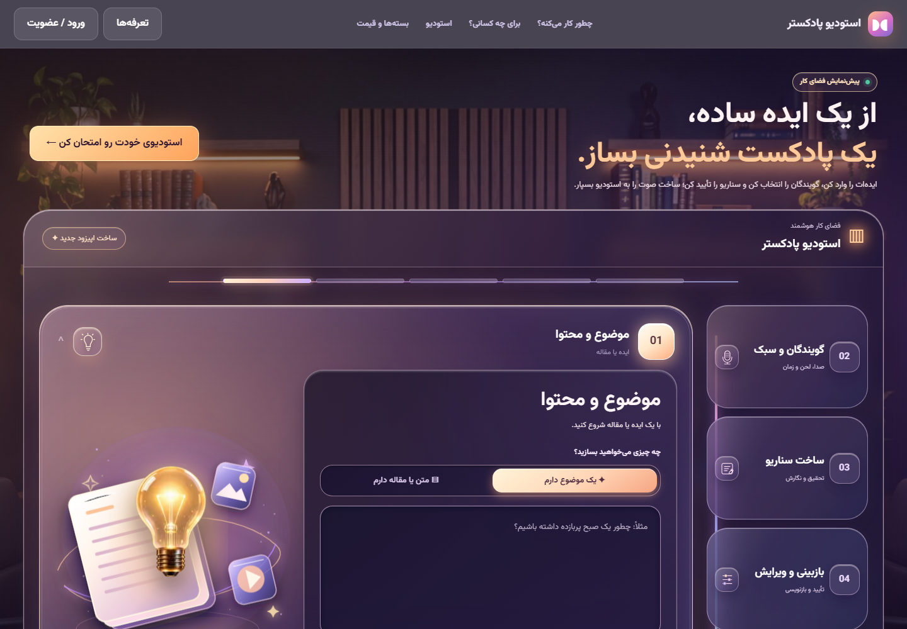
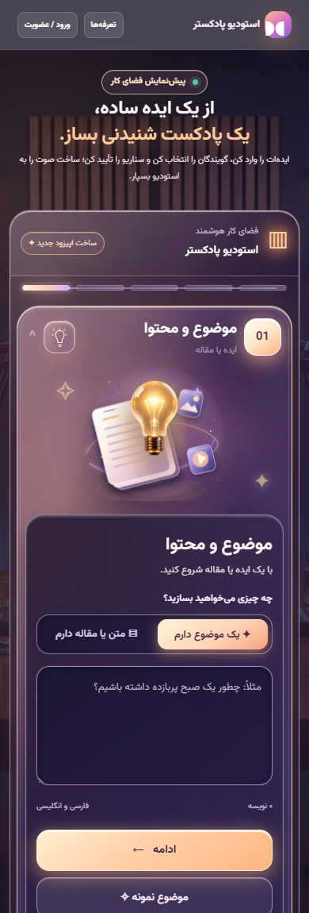
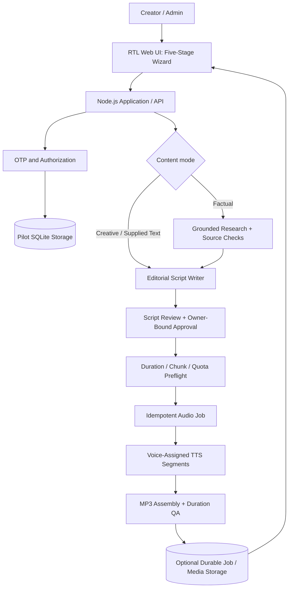

# Podcaster Studio — Persian-First AI Podcast Creation Platform

> **Project type:** Independent AI product · **Stage:** Private development / controlled pilot preparation · **Public release:** Not launched  
> **Focus:** AI workflow design, grounded content generation, multi-speaker TTS, reliability engineering, product UX, and quality validation

## Overview

**Podcaster Studio** (استودیو پادکستر) is a Persian-first web product for turning a topic, a supplied article, or a research brief into an editable podcast script and, when approved, a narrated MP3. The product is designed for creators, small organizations, educators, and teams that need a structured publishing workflow rather than a one-click, unchecked AI audio demo.

The implementation is maintained in a **separate private repository**. This public case study documents the product and the engineering decisions without publishing source code, internal provider configuration, user data, or private test media.

## The Problem

An AI podcast generator needs to do more than convert text to sound:

- factual content must not invent results, names, citations, or events;
- a five-minute selection must produce a suitably complete script *before* expensive synthesis;
- multiple voices must remain consistently assigned across audio segments;
- a user must be able to review, revise, approve, and recover their work;
- retries, rate limits, interrupted jobs, and duplicate requests must not silently multiply provider cost;
- an attractive interface should still be usable in Persian, on both mobile and desktop.

## Approved UI — Desktop and Mobile

These are **real local UI captures** of the product-owner-approved V5 interface (29 October 2026), not generative design mockups. They show the responsive Persian/RTL experience; the screenshots **do not imply a live production deployment**.

| Desktop — approved visual baseline | Mobile — approved visual baseline |
|:--:|:--:|
|  |  |

[Open desktop screenshot](../assets/podcaster-studio/desktop-approved.png) · [View full-length mobile screenshot](../assets/podcaster-studio/mobile-approved-full.png)

## Product Experience

The approved interface uses a **responsive five-stage cinematic accordion** with one prominent active stage, compact inactive stages, and visual cues that guide the creation flow. It covers:

1. A topic, custom brief, or user-supplied text.
2. One or two narrators, with independent voice selection. Two female, two male, or mixed voice combinations are supported in the development build.
3. Editorial tone, duration, and optional gentle background music.
4. An editable generated script with approval, revision, and review-history actions.
5. A controlled audio-generation job and MP3 preview/download experience.

Additional product features include opt-in closing lines, sponsor copy, contextual voice recommendations, Persian voice aliases, and role-aware account/admin workflows. These are product capabilities in the **development source**, not a claim that a publicly accessible service is live.

## Architecture Snapshot

The architecture separates **research**, **script generation**, **human approval**, **pre-TTS checks**, and **audio generation**. This matters because a plausible script is not necessarily factual, a successfully generated MP3 is not necessarily the requested length, and a successful local test is not proof of a reliable live provider.

## Technology and Integration

- **Backend:** Node.js, JavaScript ES modules, TypeScript engine modules built with esbuild.
- **Frontend:** responsive HTML/CSS/JavaScript with a Persian RTL experience.
- **AI:** Gemini-based writing/research paths, configurable alternative text-writer adapters, and Google TTS for the audio path.
- **Data and identity:** SMS OTP integration design, pilot SQLite persistence, and a PostgreSQL migration path.
- **Audio:** multi-speaker segment packing, MP3 assembly, gentle music mixing, peak-aware leveling, duration checks, and resumable segment checkpoints.
- **Delivery quality:** Node.js automated tests, local HTTP smoke tests, synthetic end-to-end tests, offline audio diagnostics, and documented release gates.

Provider-specific availability, regional access, and model cost are not treated as guaranteed.

## Reliability and Responsible-AI Decisions

### Evidence-first factual content
Factual prompts are routed separately from fiction or user-supplied text. Research/source checks and stricter sports-fact guardrails aim to reduce fabricated match scores, scorers, and source claims. Higher-risk outputs remain subject to **human editorial review**; the validation layer is not described as infallible.

### Script approval before synthesis
The server binds approvals to the user and the exact script/episode specification. Duration estimation and chunk-count checks happen **before** TTS. Underfilled output is flagged; optional credit enforcement is designed to reject settling a too-short output as a paid success.

### Cost-aware job handling
Duplicate audio-render requests use idempotent jobs. Completed segments can be checkpointed and reused in a controlled resume; uncertain in-flight provider calls are **not silently replayed**. Quota limits and failure states are modeled explicitly.

### Privacy and operational boundaries
Credentials and private evaluation media remain out of Git. Sensitive source fetching is gated pending network-level SSRF safeguards. The private source is kept separate from other product deployments and production environments.

## Evidence and Validation (as of 31 October 2026)

| Evidence level | What was checked | What it does **not** prove |
| --- | --- | --- |
| UI / functional tests | Responsive accordion, script review, independent narrator selection, and mocked provider flows | Live API availability or broadcast-level voice quality |
| Local HTTP end-to-end | A synthetic five-minute two-voice order reached a 300-second MP3 through real local HTTP routes and encoding | Real Persian narration: writer and TTS responses were mocked |
| Offline capacity matrix | 32/32 synthetic duration / content combinations fit the modeled 12-segment ceiling after an experimental packing change | Actual 10–15-minute provider synthesis or natural prosody |
| Real, limited Free Tier pilots | Short Persian voice samples and a real five-minute **writer-only** script; selected listening samples received product-owner feedback of **4/5** | A full five-minute real-provider script-to-MP3 order, every voice pairing, or commercial launch readiness |

**Current gate:** No production launch, active checkout, or paid customer onboarding is claimed. A full five-minute provider-backed end-to-end acceptance test, longer-form audio continuity, provider quota checks, and security/release review remain necessary.

## My Contribution

My involvement spans product and technical delivery rather than solely frontend coding:

- defined the end-user workflow, content modes, acceptance criteria, and visual direction;
- directed the RTL five-stage UX and reviewed iterative desktop/mobile designs;
- specified factual-research policies, script-review controls, and duration requirements;
- coordinated architecture and implementation across the writer, TTS, identity, job, and data layers;
- prioritized low-cost, deterministic validation and controlled provider pilots;
- translated listening feedback into concrete improvements to voice selection, musical bed, volume consistency, and episode endings;
- tracked reliability limitations, test evidence, and no-go conditions for production deployment.

## What This Demonstrates

This work illustrates **AI product implementation**, **workflow architecture**, **API/provider integration**, **human-in-the-loop content quality**, **stateful job reliability**, **multilingual UX**, and **disciplined pilot validation**.

The most important design principle is to separate what the application can **simulate locally**, what users have **listened to and evaluated**, and what has actually been **verified end-to-end with production-like providers**.

## Confidentiality

This case study is intentionally sanitized. Source code, credentials, personal data, private generated media, internal deployment configuration, and customer information are not disclosed. The original repository remains private.
